# Projet E5 — 5SDWANA Metz : déploiement d'un MVP e-commerce sur Kubernetes

> **Empreinte du groupe :** `jtsr-04-11-2026` — présente dans le nom de chaque image, conteneur, réseau et composant Kubernetes.
> **Label personnel :** `nom: jonathan` sur tous les composants Kubernetes (avec `projet: e5`).

| Membre | Rôle dans le projet |
| --- | --- |
| Jonathan BERNARD | Responsable Kubernetes (déploiement) |
| Tomy HOMBOURGER | Responsable Git et documentation |
| Romain FIGAROLI | Responsable Docker (images) |
| Soulaymane KADI | Responsable tests et observabilité |

---

## 1. Objectif

Déployer, dans un environnement de développement Kubernetes, **3 applications conteneurisées** servant de MVP pour un client e-commerce :

- une application de **paiement Stripe** (obligatoire) ;
- deux applications légères au choix ;
- **3 réplicas** par application, un **autoscaling de 3 à 20 pods**, des **limites CPU/RAM** réalistes ;
- **une application accessible uniquement depuis l'intérieur** du cluster, les deux autres depuis l'extérieur ;
- toute la stack déployée **« as code »** (manifests YAML versionnés dans ce dépôt) ;
- **3 environnements isolés** : `mlops`, `preprod`, `prod` (partie 2) ;
- une solution d'**observabilité** avec interface web (partie 3).

## 2. Solutions choisies

| Besoin | Solution | Pourquoi |
| --- | --- | --- |
| Cluster Kubernetes | **Minikube** (driver Docker) dans une VM Ubuntu Multipass | Cluster complet sur une seule machine, idéal pour un environnement de développement |
| Conteneurisation | **Docker** | Construction des images (`docker build`) et publication |
| Registre d'images | **Docker Hub** (`jonathan57/…`) | Exigé par le sujet ; images publiques récupérées par le cluster |
| Application Stripe | **Stripe Checkout** — exemple officiel `stripe-samples/checkout-one-time-payments` (Python / Flask) | MVP officiel de Stripe, configuré uniquement par variables d'environnement |
| Application 2 | **Todo App** — `docker/getting-started-app` (Node.js) | Application web légère avec interface |
| Application 3 | **API Flask** — `docker/awesome-compose/nginx-wsgi-flask` (Python) | API très légère, idéale pour l'accès interne uniquement |
| Configuration | **ConfigMap** | Configuration non sensible séparée du code |
| Données sensibles | **Secret** | Clés API Stripe injectées sans être écrites dans le dépôt |
| Autoscaling | **HorizontalPodAutoscaler** + addon **metrics-server** | Scaling horizontal automatique sur le CPU |
| Test de charge | **Apache Bench (`ab`)** | Outil de test de charge HTTP simple et standard |
| Observabilité | **Netdata** | Interface web temps réel, déploiement simple |
| Versionnement | **Git / GitHub** | Historique de toutes les étapes (commits réguliers) |

## 3. Architecture

```
PC (navigateur, curl)
   │  IP de la VM : ports 8081, 8082, 19999 (port-forward)
   ▼
VM Ubuntu (Multipass)
└── Minikube (nœud Kubernetes, driver Docker)
    ├── namespace mlops-jtsr-04-11-2026   ┐
    ├── namespace preprod-jtsr-04-11-2026 ├─ même stack, déployée à l'identique
    ├── namespace prod-jtsr-04-11-2026    ┘
    │     ├── shop  (Stripe)   Deployment 3 réplicas · Service NodePort   · HPA 3→20 · ConfigMap + Secret
    │     ├── todo  (Node.js)  Deployment 3 réplicas · Service NodePort   · HPA 3→20
    │     └── api   (Flask)    Deployment 3 réplicas · Service ClusterIP  · HPA 3→20   (interne uniquement)
    └── namespace monitoring-jtsr-04-11-2026
          └── netdata          Deployment 1 réplica  · Service NodePort  (interface web :19999)
```

Le schéma détaillé :

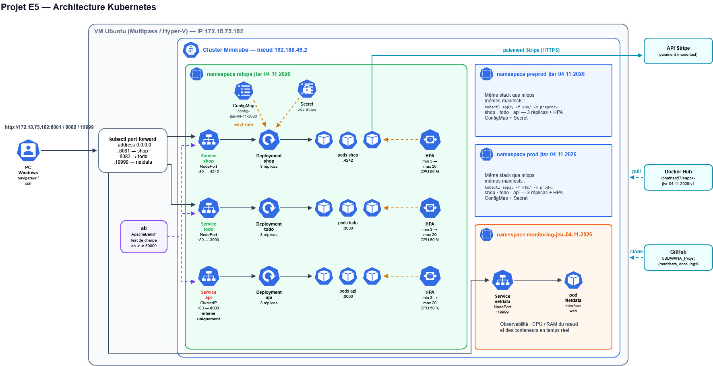

## 4. Applications

| Application | Image Docker Hub | Port conteneur | Service | Accès |
| --- | --- | --- | --- | --- |
| shop (Stripe) | `jonathan57/shop-jtsr-04-11-2026:v1` | 4242 | NodePort (port 80) | Extérieur |
| todo | `jonathan57/todo-jtsr-04-11-2026:v1` | 3000 | NodePort (port 80) | Extérieur |
| api | `jonathan57/api-jtsr-04-11-2026:v1` | 8000 | ClusterIP (port 80) | **Intérieur uniquement** |
| netdata | `netdata/netdata:stable` | 19999 | NodePort (port 19999) | Extérieur |

### Optimisation des images

- Images de base **`alpine`** (`python:3.12-alpine`, `node:22-alpine`).
- `pip install --no-cache-dir`, `npm ci --omit=dev` puis `npm cache clean` : pas de cache ni de dépendances de développement.
- Fichiers **`.dockerignore`** pour ne copier que le nécessaire.
- Exécution en **utilisateur non-root** (`nobody`, `node`).
- Serveur de production **gunicorn** pour les applications Python.
- Comparaison avec une image non optimisée : `apps/api/Dockerfile.naive` (tailles dans `logs/taille-images-jtsr-04-11-2026.log`).

| Image | Taille |
| --- | --- |
| api | 97,3 Mo |
| shop | 129 Mo |
| todo | 289 Mo |

**Les 3 images publiées sur Docker Hub :**

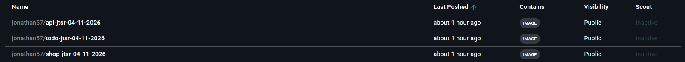

**Tailles des images (`docker images`), avec la comparaison `Dockerfile.naive` :**

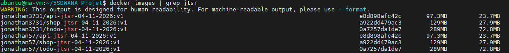

### Limites de ressources

Mesurées au préalable avec `kubectl top pods`, puis fixées dans chaque Deployment :

| Application | requests (CPU / RAM) | limits (CPU / RAM) |
| --- | --- | --- |
| shop | 50m / 64Mi | 200m / 192Mi |
| todo | 50m / 64Mi | 200m / 256Mi |
| api | 50m / 64Mi | 200m / 192Mi |

**Mesure de la consommation avant de fixer les limites (`kubectl top pods`) :**

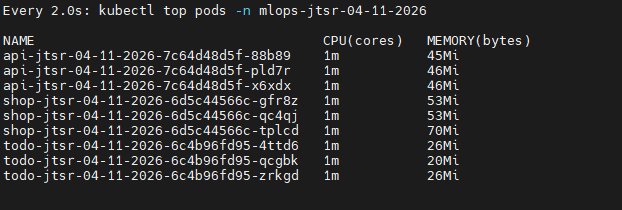

**Limites appliquées dans un pod (`kubectl describe pod`, partie Limits / Requests) :**

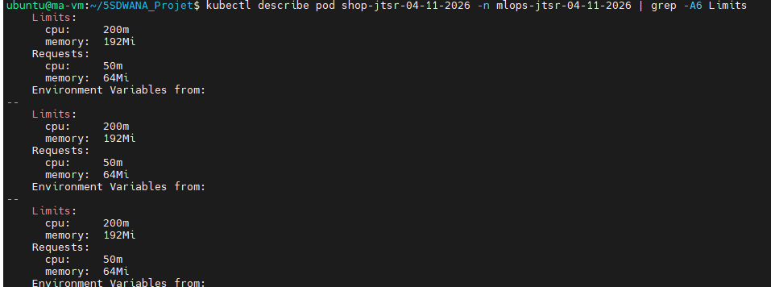

## 5. Arborescence du dépôt

```
.
├── apps/                    # code source et Dockerfile de chaque application
│   ├── shop/                # Stripe Checkout (Python/Flask)
│   ├── todo/                # Todo App (Node.js)
│   └── api/                 # API Flask (Dockerfile optimisé + Dockerfile.naive)
├── k8s/                     # stack applicative « as code » (sans namespace : réutilisable)
│   ├── 00-configmap.yaml
│   ├── shop.yaml            # Deployment + Service + HPA
│   ├── todo.yaml
│   └── api.yaml
├── namespaces/
│   └── namespaces.yaml      # mlops, preprod, prod
├── observability/
│   └── netdata.yaml         # namespace monitoring + Deployment + Service Netdata
├── logs/                    # historique des commandes, events, describe, logs Docker
├── erreurs-projet.md        # erreurs rencontrées : objectif, commande, erreur, solution
└── .gitignore               # exclut notamment les fichiers *.env (secrets)
```

## 6. Déploiement pas à pas

### 6.1 Prérequis

```bash
minikube start --driver=docker
minikube addons enable metrics-server    # nécessaire au HPA et à kubectl top
```

### 6.2 Construire et publier les images

```bash
docker login
docker build -t jonathan57/shop-jtsr-04-11-2026:v1 apps/shop
docker build -t jonathan57/todo-jtsr-04-11-2026:v1 apps/todo
docker build -t jonathan57/api-jtsr-04-11-2026:v1  apps/api
docker push jonathan57/shop-jtsr-04-11-2026:v1
docker push jonathan57/todo-jtsr-04-11-2026:v1
docker push jonathan57/api-jtsr-04-11-2026:v1
```

### 6.3 Créer les namespaces

```bash
kubectl apply -f namespaces/
```

### 6.4 Créer le Secret Stripe (jamais versionné)

Les clés Stripe ne sont **pas** dans le dépôt. Le fichier `secret.env` (ignoré par Git) contient un manifest de type `Secret` :

```yaml
apiVersion: v1
kind: Secret
metadata:
  name: stripe-secret-jtsr-04-11-2026
  labels:
    nom: jonathan
    projet: e5
type: Opaque
stringData:
  STRIPE_SECRET_KEY: "sk_test_..."
  STRIPE_PUBLISHABLE_KEY: "pk_test_..."
  PRICE: "price_..."
  DOMAIN: "http://172.18.75.182:8081"
```

```bash
kubectl apply -f secret.env -n mlops-jtsr-04-11-2026
kubectl apply -f secret.env -n preprod-jtsr-04-11-2026
kubectl apply -f secret.env -n prod-jtsr-04-11-2026
rm secret.env
```

**Le Secret existe dans le namespace (`kubectl get secret`) :**

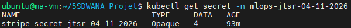

**Les variables de la ConfigMap et du Secret sont injectées dans le pod (`printenv`, clés masquées) :**

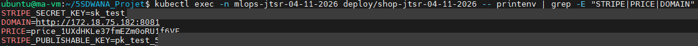

### 6.5 Déployer la stack dans les 3 environnements (partie 2)

Les manifests de `k8s/` ne fixent pas de namespace : **les mêmes fichiers** sont appliqués à l'identique dans chaque environnement.

```bash
kubectl apply -f k8s/ -n mlops-jtsr-04-11-2026
kubectl apply -f k8s/ -n preprod-jtsr-04-11-2026
kubectl apply -f k8s/ -n prod-jtsr-04-11-2026
kubectl get deploy,pods,svc,hpa -A -l projet=e5
```

**La stack déployée à l'identique dans `mlops`, `preprod` et `prod` (3 réplicas par application) :**

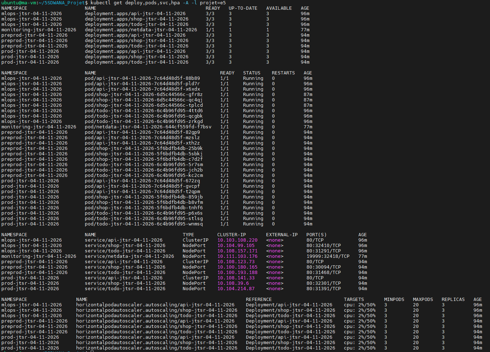

**Les labels `nom` et `projet` sur les composants (`--show-labels`) :**

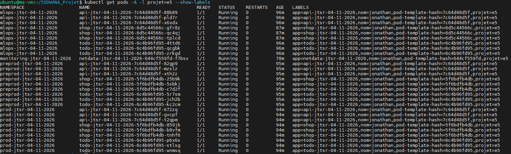

### 6.6 Déployer l'observabilité (partie 3)

```bash
kubectl apply -f observability/netdata.yaml
```

## 7. Accès aux applications

Depuis la VM, ouverture des accès vers l'extérieur (vers l'IP de la VM) :

```bash
kubectl port-forward --address 0.0.0.0 -n mlops-jtsr-04-11-2026 svc/shop-jtsr-04-11-2026 8081:80 > /dev/null 2>&1 &
kubectl port-forward --address 0.0.0.0 -n mlops-jtsr-04-11-2026 svc/todo-jtsr-04-11-2026 8082:80 > /dev/null 2>&1 &
kubectl port-forward --address 0.0.0.0 -n monitoring-jtsr-04-11-2026 svc/netdata-jtsr-04-11-2026 19999:19999 > /dev/null 2>&1 &
```

| Application | URL depuis le PC |
| --- | --- |
| shop (Stripe) | `http://172.18.75.182:8081` |
| todo | `http://172.18.75.182:8082` |
| Netdata | `http://172.18.75.182:19999` |
| api | non exposée — test depuis l'intérieur du cluster ci-dessous |

Test de l'API **depuis l'intérieur** du cluster (Service ClusterIP) :

```bash
kubectl run curl-jtsr-04-11-2026 --rm -it --restart=Never --image=curlimages/curl \
  -n mlops-jtsr-04-11-2026 -- curl -s http://api-jtsr-04-11-2026/flask-health-check
```

**Les Services : `api` en ClusterIP (interne), `shop` et `todo` en NodePort (`kubectl get svc`) :**

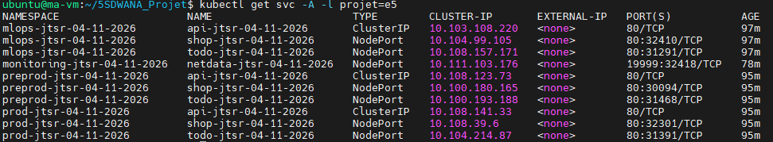

**L'API répond depuis l'intérieur du cluster :**

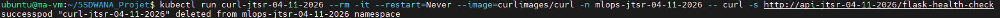

**`shop` depuis le PC (navigation privée) :**

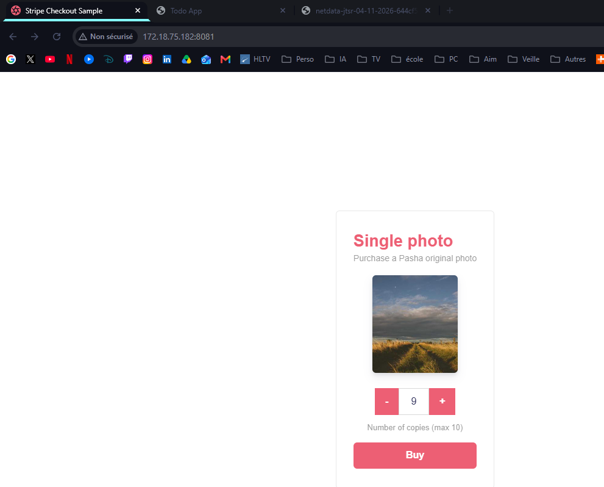

**`todo` depuis le PC (navigation privée) :**

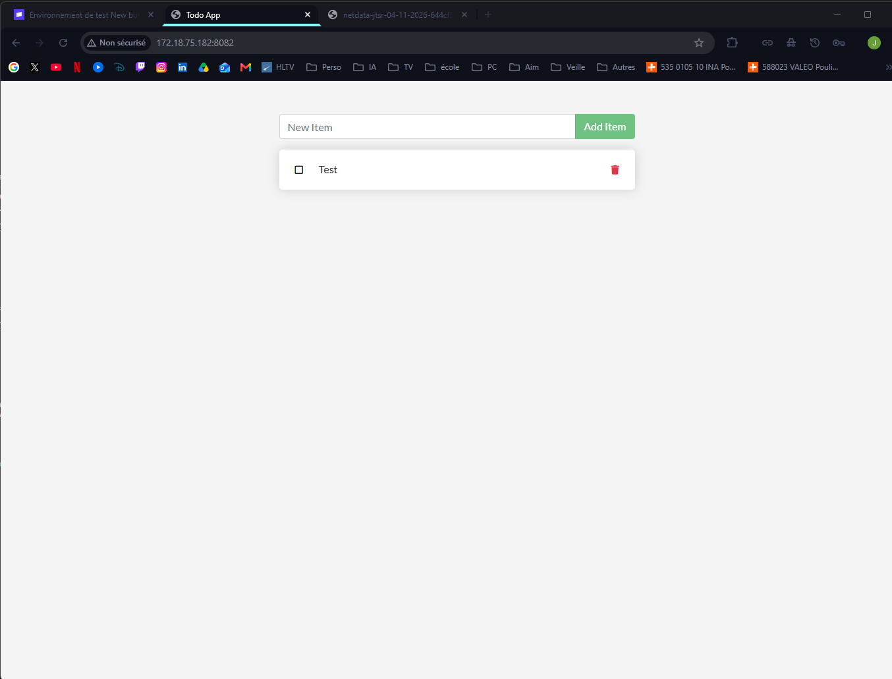

## 8. Tests

### 8.1 Test de paiement Stripe

1. Ouvrir `http://172.18.75.182:8081` et cliquer sur **Buy**.
2. Payer avec la carte de test `4242 4242 4242 4242` (date future, CVC quelconque).
3. Vérifier que le paiement apparaît dans le tableau de bord Stripe → **Paiements** (mode test).

**Page de paiement Stripe :**

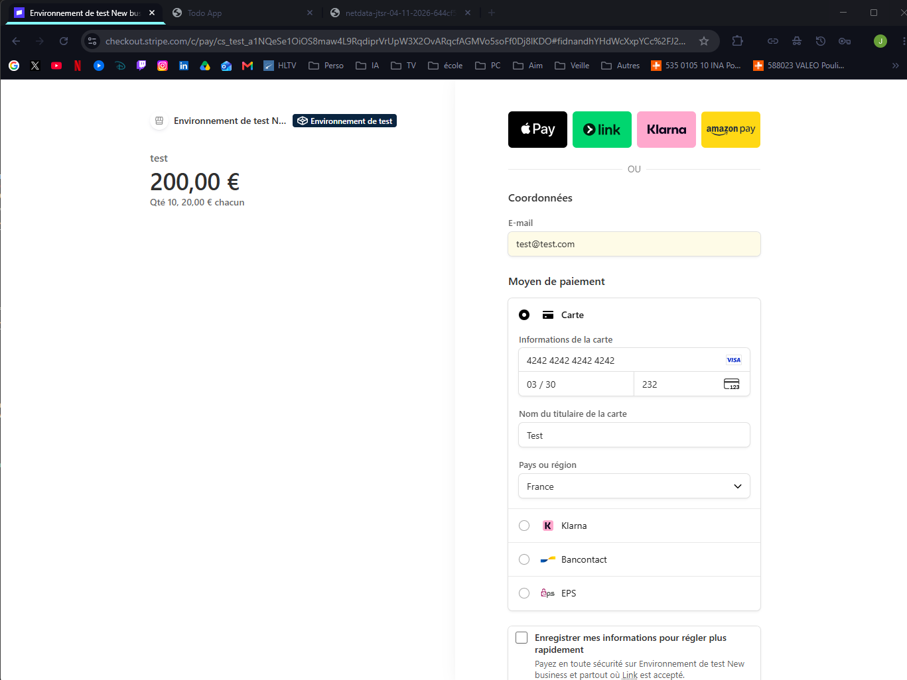

**Page de succès après le paiement :**

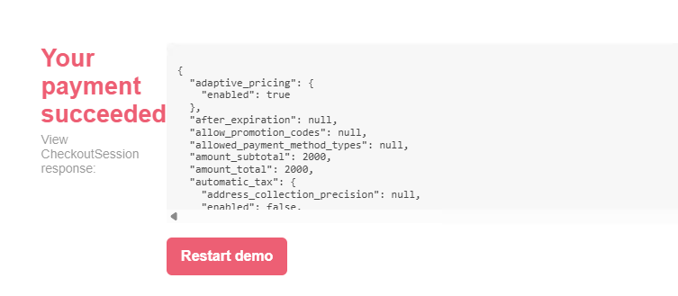

**Le paiement remonte dans l'interface web de Stripe :**

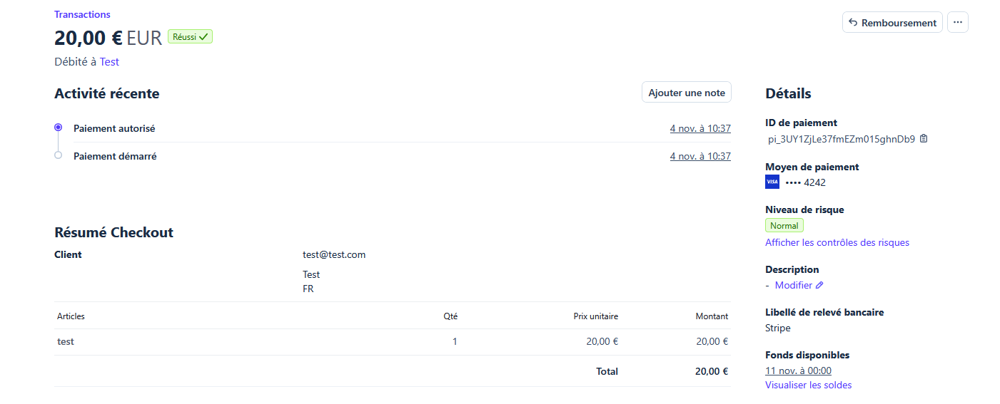

### 8.2 Test de charge, autoscaling et downscaling

```bash
minikube ip
kubectl get svc -n mlops-jtsr-04-11-2026                       # récupérer les nodePort
ab -n 50000 -c 100 http://<IP-minikube>:<nodePort>/            # 50 000 requêtes, 100 en parallèle
kubectl get hpa -n mlops-jtsr-04-11-2026 -w                     # suivre le scaling en direct
kubectl top pods -n mlops-jtsr-04-11-2026
```

- **Autoscaling** : au-dessus de 50 % du CPU demandé, le HPA ajoute des pods (20 au maximum).
- **Downscaling** : après la charge, retour à 3 pods (fenêtre de stabilisation de 60 s définie dans `behavior.scaleDown`).

**Premier essai sur `shop` : le test s'arrête à 18 689 requêtes (`Connection refused`) pendant le scaling** — voir `erreurs-projet.md` :

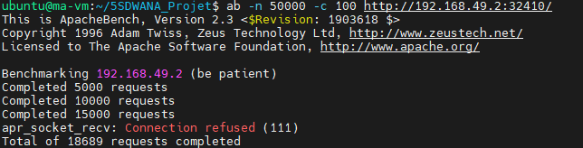

**Test de charge complet sur `shop` (`ab -r -n 50000 -c 100`) :**

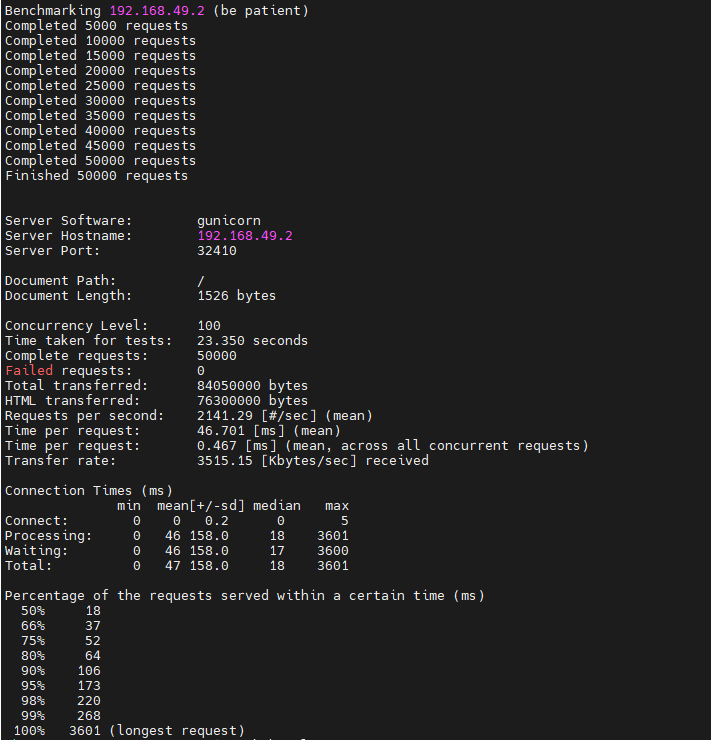

| Indicateur | Résultat |
| --- | --- |
| Requêtes réussies | 50 000 / 50 000 (**0 échec**) |
| Durée du test | 23,35 s |
| Débit | **2 141 requêtes/s** |
| Temps de réponse médian | 18 ms |
| 95 % des requêtes | en moins de 173 ms |
| Requête la plus longue | 3,6 s (pendant l'ajout des pods) |

> **Analyse :** avec 100 connexions simultanées, `shop` traite plus de 2 100 requêtes par seconde sans aucune erreur. La grande majorité des requêtes répond en moins de 200 ms ; les quelques requêtes lentes (jusqu'à 3,6 s) correspondent au moment où les pods existants étaient saturés, avant que les nouveaux pods créés par le HPA prennent le relais.

**Test de charge sur `todo` (`ab -r -n 50000 -c 100`) :**

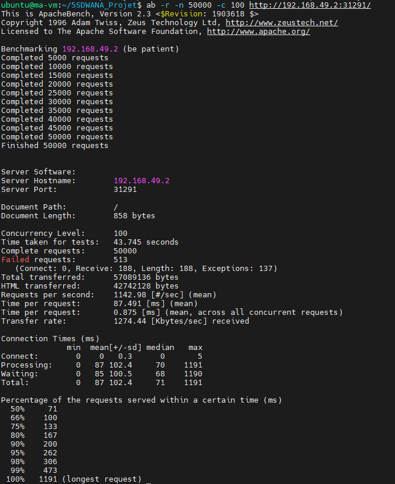

| Indicateur | Résultat |
| --- | --- |
| Requêtes | 50 000, dont **513 en échec (1 %)** |
| Durée du test | 43,7 s |
| Débit | **1 143 requêtes/s** |
| Temps de réponse médian | 71 ms |
| 95 % des requêtes | en moins de 262 ms |
| Requête la plus longue | 1,2 s |

**Le HPA passe `todo` de 3 à 11 réplicas pendant la charge (180 % pour une cible de 50 %) :**

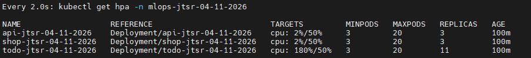

> **Analyse :** `todo` (Node.js) traite environ deux fois moins de requêtes par seconde que `shop`, avec des temps de réponse plus élevés. Les 513 échecs (1 %) apparaissent pendant l'ajout des nouveaux pods : du trafic est envoyé à des pods qui ne sont pas encore prêts, d'où des connexions coupées (`Receive`, `Exceptions`) et des réponses incomplètes (`Length`). L'ajout d'une `readinessProbe` (voir `erreurs-projet.md`) permet de n'envoyer le trafic qu'aux pods prêts.

**Test de charge sur `api`, lancé depuis un pod `ab-jtsr-04-11-2026` à l'intérieur du cluster (l'API étant en ClusterIP) :**

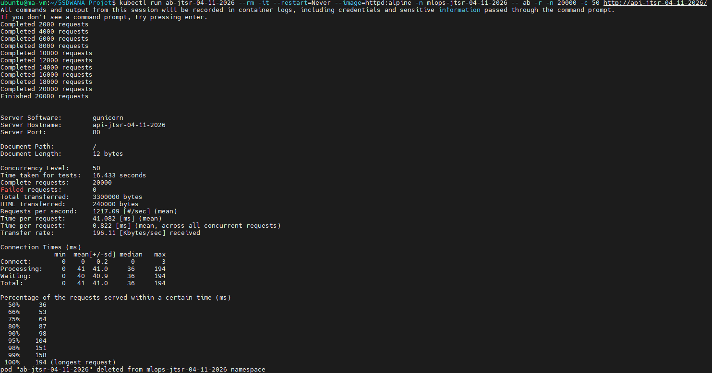

| Indicateur | Résultat |
| --- | --- |
| Requêtes | 20 000 / 20 000 (**0 échec**) |
| Durée du test | 16,4 s |
| Débit | **1 217 requêtes/s** |
| Temps de réponse médian | 36 ms |
| 95 % des requêtes | en moins de 104 ms |
| Requête la plus longue | 194 ms |

**Le HPA passe `api` de 3 à 7 réplicas pendant la charge (132 % pour une cible de 50 %) :**

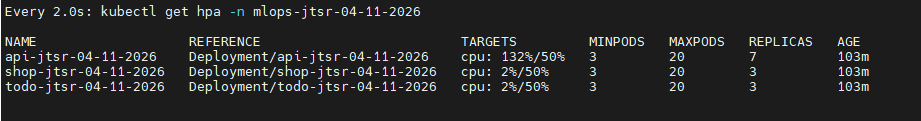

> **Analyse :** l'API, très légère (réponse de 12 octets), répond sans aucune erreur et avec les temps de réponse les plus réguliers des trois applications (maximum 194 ms). Le test étant lancé depuis l'intérieur du cluster, il prouve aussi que l'API reste joignable par son nom DNS (`api-jtsr-04-11-2026`) alors qu'elle n'est pas exposée à l'extérieur.

### Synthèse des tests de charge

| Application | Requêtes | Échecs | Débit | Médiane | Pods max atteints |
| --- | --- | --- | --- | --- | --- |
| shop | 50 000 | 0 | 2 141 req/s | 18 ms | 20 |
| todo | 50 000 | 513 (1 %) | 1 143 req/s | 71 ms | 11 |
| api | 20 000 | 0 | 1 217 req/s | 36 ms | 8 |

Dans les trois cas, l'autoscaling se déclenche dès que le CPU dépasse 50 % des `requests`, et le downscaling ramène chaque application à 3 pods une fois la charge terminée.

**Avant la charge : les 3 applications au repos (2 % de CPU), 3 réplicas chacune :**

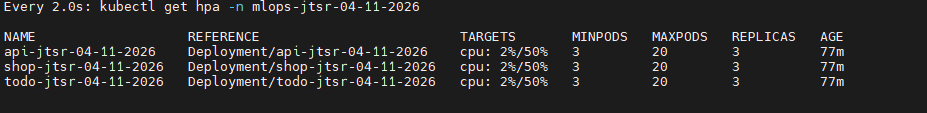

**Début de la charge : le CPU de `shop` dépasse la cible (159 % pour 50 %), encore 3 réplicas :**

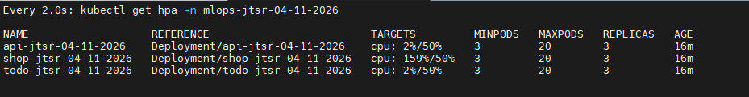

**Autoscaling : le HPA passe `shop` de 3 à 10 réplicas pendant la charge (`kubectl get hpa -w`) :**

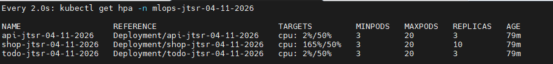

**Consommation pendant la charge (`kubectl top pods`) : 10 pods `shop` entre 104m et 196m de CPU, mémoire stable (52 à 69 Mi) :**

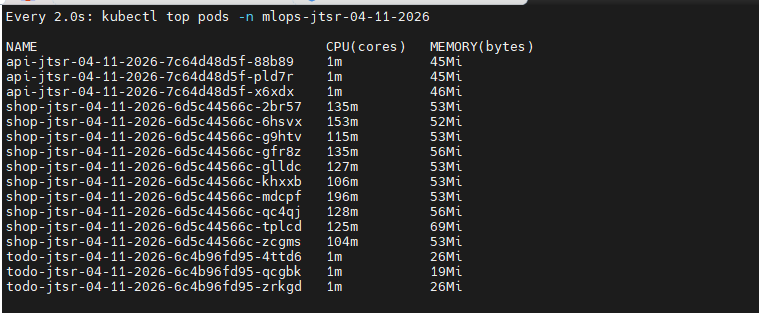

> **Analyse :** la charge ne porte que sur `shop` (cible du test) ; `api` et `todo` restent à 1m de CPU. Chaque pod `shop` approche sa limite de 200m de CPU, alors que la mémoire reste loin de sa limite (192 Mi) : l'application est limitée par le CPU, ce qui confirme le choix d'un HPA basé sur le CPU. Le HPA monte par paliers (3 → 7 → 10, puis 20 au maximum autorisé, visible dans les events ci-dessous), puis redescend directement à 3 une fois la charge terminée (« All metrics below target »).

**Downscaling : après la charge, `shop` est revenu à 3 pods et le CPU à 1m (`kubectl top pods`) :**


**Netdata pendant le test de charge (accès depuis le PC) :**

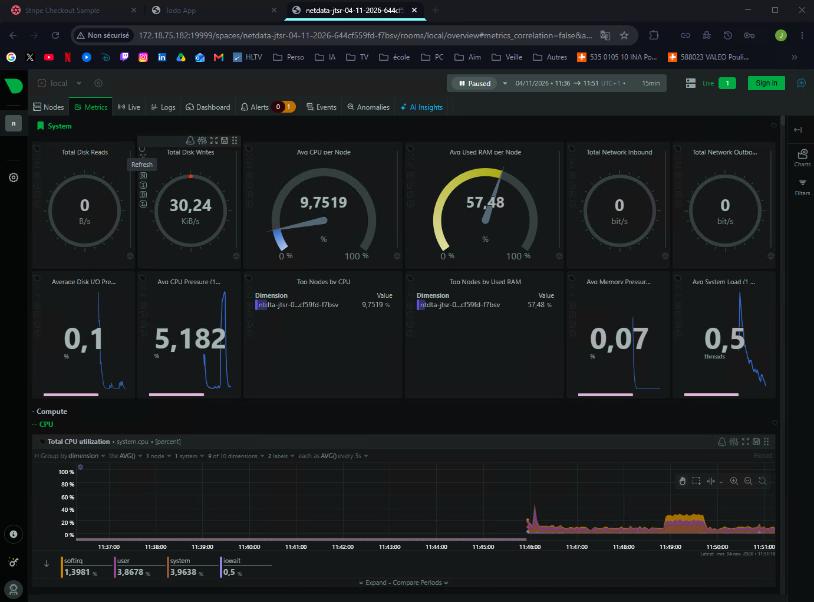

**Netdata, vue détaillée du pod pendant la charge (pics de CPU à chaque test) :**

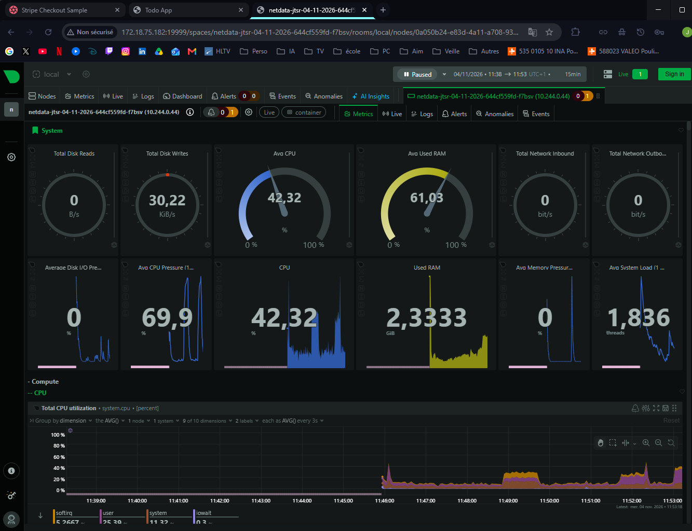

## 9. Logs fournis

| Fichier | Contenu |
| --- | --- |
| `logs/history-projet-BERNARD-jonathan.log` | Historique des commandes Linux |
| `logs/k8s-events-BERNARD-jonathan.log` | `kubectl get events -A` |
| `logs/k8s-describe-BERNARD-jonathan.log` | `kubectl describe` des composants |
| `logs/k8s-labels-jtsr-04-11-2026.log` | Composants avec leurs labels (`nom`, `projet`) |
| `logs/docker-api-jtsr-04-11-2026.log` | `docker logs` du conteneur api |
| `logs/pod-todo-jtsr-04-11-2026.log` | Logs d'un pod todo |
| `logs/taille-images-jtsr-04-11-2026.log` | Taille des images construites |
| `erreurs-projet.md` | Erreurs rencontrées et leur résolution |

**Tableau des events (`kubectl get events`) :**

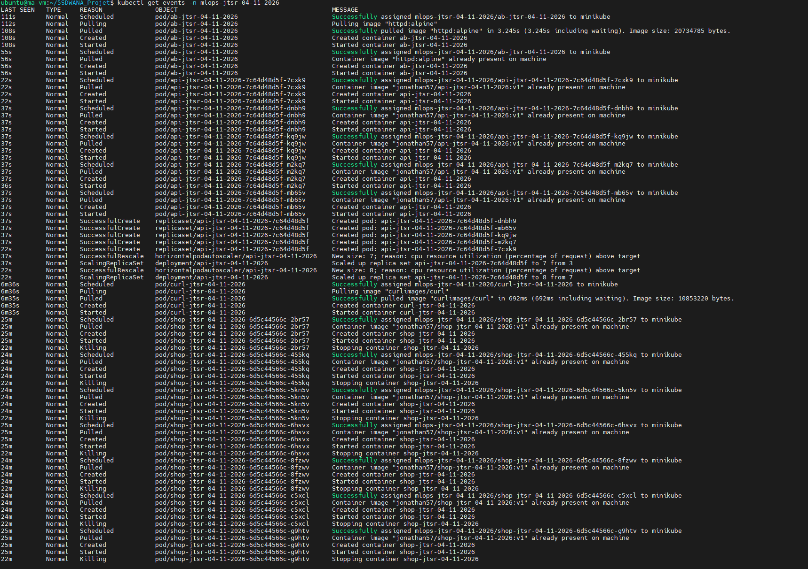

**Events du scaling de `shop` : le HPA monte à 7, 10 puis 20 pods, puis redescend à 3 (« All metrics below target ») :**

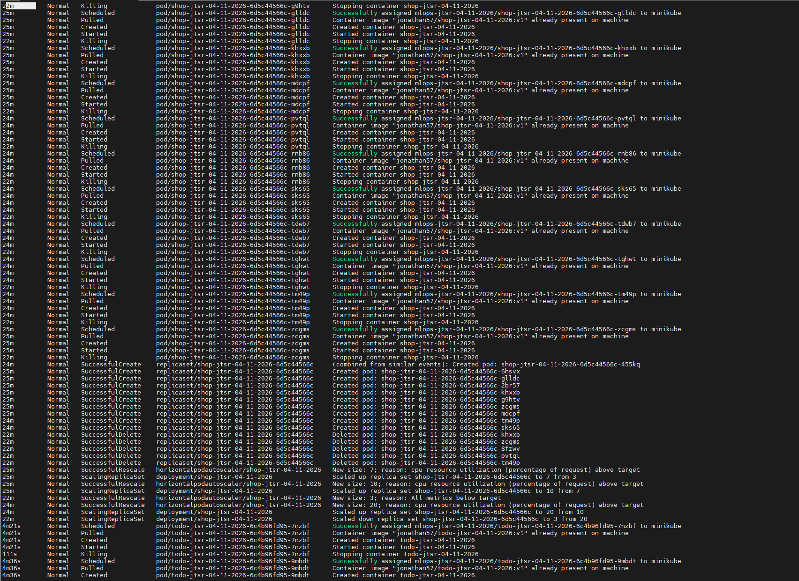

**Events du scaling de `todo` : montée à 7 puis 11 pods, puis retour à 3 :**

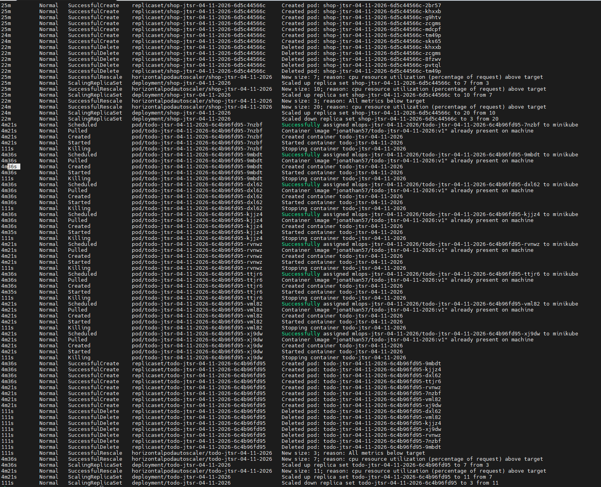

**Historique des commits Git :**

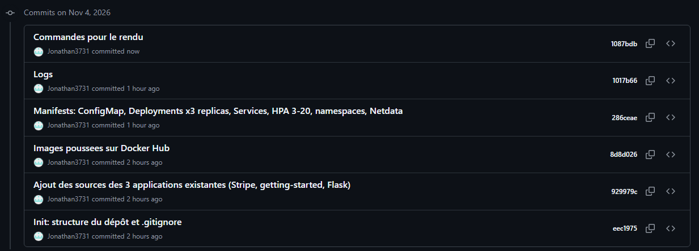

## 10. Avantages et inconvénients des choix

| Choix | Avantages | Inconvénients |
| --- | --- | --- |
| Minikube | Cluster complet en local, gratuit, rapide à installer | Un seul nœud : pas de vraie haute disponibilité ; accès externe à « bricoler » (port-forward) |
| Images alpine | Images légères, surface d'attaque réduite | Certaines bibliothèques natives plus délicates à installer |
| NodePort | Simple, sans infrastructure supplémentaire | Ports imposés (30000–32767), réservé au dev/test |
| ClusterIP pour l'API | API non exposée : plus sûr | Test uniquement depuis l'intérieur du cluster |
| Secret Kubernetes | Clés hors du code et du dépôt | Stocké en base64, non chiffré par défaut dans etcd |
| HPA sur le CPU | Natif, simple à mettre en place | Nécessite metrics-server et des `requests` correctes |
| Netdata | Interface web temps réel, déploiement en un manifest | En simple Deployment, visibilité limitée au pod ; une installation en DaemonSet (Helm) donnerait une vue complète des nœuds |
| Apache Bench | Simple, disponible partout | Moins riche que k6 ou Locust (pas de scénarios) |
